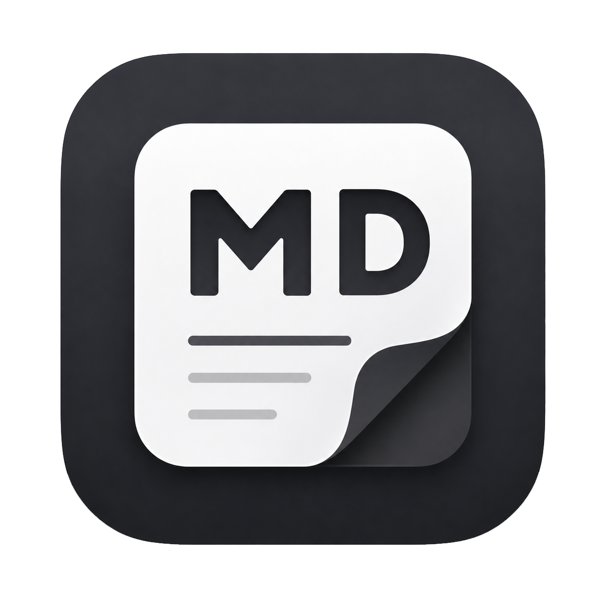

# MD reader

<p align="center">
  
</p>

A clean macOS markdown reader & editor built with Electron.

## Features

- **Reading Mode (Default)** — Opens `.md` files in full-width rendered preview, with an outline panel. Each document remembers its scroll position.
- **Edit Mode** — Split view: source on the left, live preview on the right, scroll-synced by source line. Entering edit mode starts at the paragraph you were reading. The editor loads on first use.
- **Multi-Document** — Collapsible document list with a count badge; Open Recent in the File menu and on the welcome screen.
- **Markdown** — GFM tables, strikethrough, task lists, footnotes, GitHub alerts (`> [!NOTE]`), YAML front matter shown as a collapsible card, heading anchors (`#section`, `other.md#section`), code highlighting for 29 languages with a copy button.
- **Local files** — Relative images and links resolve against the document folder, including CJK names and spaces. External edits (including atomic saves from VS Code / vim) reload automatically.
- **Theme** — Follows the system appearance by default; View › Theme picks System / Light / Dark. `Cmd+Shift+T` toggles light/dark.
- **Rendering switches** — View › Rendering: single line break as new line, smart quotes and symbols.
- **Interface language** — Chinese or English, following the system language.
- **Keyboard Shortcuts** — `Cmd+E` toggle mode, `Cmd+O` open, `Cmd+S` save, `Cmd+F` find, `Cmd+B` document list, `Cmd+Shift+O` outline.
- **Drag & Drop** — Drop `.md` files onto the window.

## Install

Download `MD reader.app` from the repository Releases page, then drag it to `/Applications`.

> First launch: right-click → Open → confirm (unsigned app).

## Build from Source

```bash
git clone <repository-url>
cd <repository-directory>
npm install
npm start          # Run in development
npm test           # Node-level regression checks
npm run pack       # Package to .app
npm run build      # Package to .app + .dmg
```

## Tech Stack

| Component | Choice |
|-----------|--------|
| Framework | Electron |
| Markdown | markdown-it |
| Code Highlighting | highlight.js |
| Editor | CodeMirror 6 |
| Packaging | electron-builder |

## License

MIT. See [LICENSE](LICENSE).
